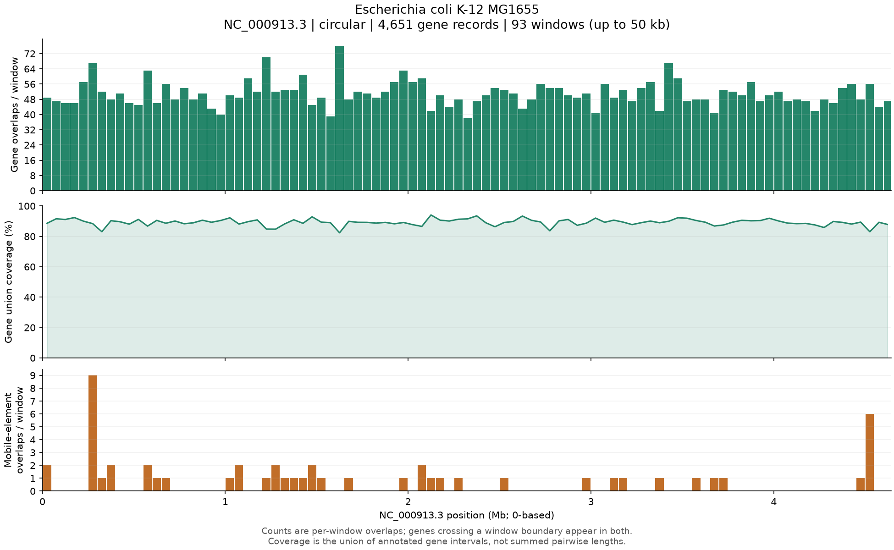
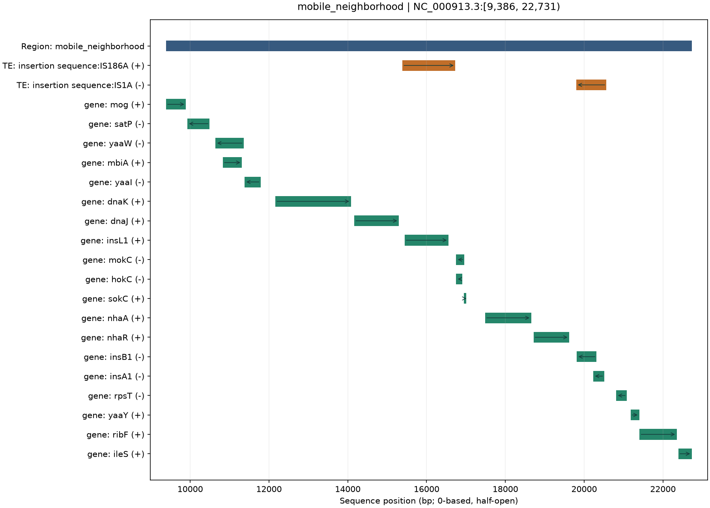
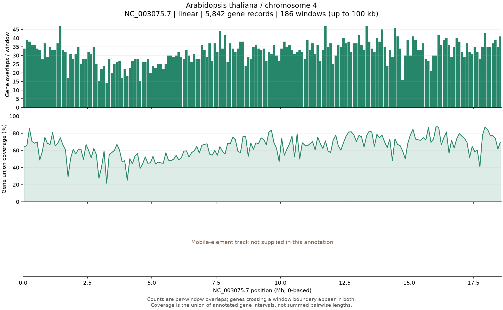
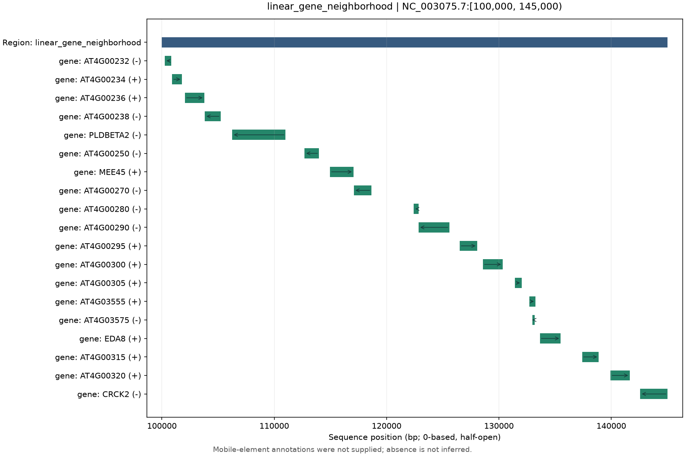

# Real-annotation DEMO: circular bacterium and linear plant chromosome

[KNOWN] This directory contains two public annotation snapshots, conversion and
analysis code, computed tables, and PNG/SVG figures. The annotations are real;
analysis windows are deliberately chosen demonstration intervals, not discovered
biological islands or experimentally defined loci.

## Sources and scope

[KNOWN] Both source files were retrieved from the public NCBI assembly annotation
archive. The exact URLs, assembly versions, filtering operation and SHA-256
checksums of uncompressed contents are in [`data/sources.json`](data/sources.json).

| Dataset | Assembly / sequence | Topology | Full sequence length | Selected annotation records |
| --- | --- | --- | ---: | --- |
| [COMPUTED] *Escherichia coli* K-12 MG1655 | `GCF_000005845.2` / `NC_000913.3` | Circular | 4,641,652 bp | 4,506 `gene` + 145 `pseudogene`; 50 `mobile_genetic_element` |
| [COMPUTED] *Arabidopsis thaliana*, chromosome 4 | `GCF_000001735.4` / `NC_003075.7` | Linear | 18,585,056 bp | 5,007 `gene` + 835 `pseudogene`; no separate mobile-element track supplied |

[KNOWN] The bacterial GFF3 is the complete downloaded file. The plant GFF3 is a
chromosome-only subset of the full assembly annotation: **all records on chromosome
4**, including transcripts, exons and CDSs, remain in the saved source file. The
converter selects only `gene` and `pseudogene` rows for counting; it does not count
exons or isoforms as additional genes. Thus the reported 4,651 and 5,842 counts
include pseudogenes and non-protein-coding gene records.

[KNOWN] Mobile elements are taken only from explicit selected feature types, not
inferred from transposase gene names. `annotation_type` retains the source type;
`feature_type=TE` and `te_count` retain the original API's compatibility labels.
The plant source has no selected mobile-element feature rows. Its omitted track
means **not supplied**, not that this chromosome has no transposable elements.

[KNOWN] Source links:

- [Bacterial annotation](https://ftp.ncbi.nlm.nih.gov/genomes/all/GCF/000/005/845/GCF_000005845.2_ASM584v2/GCF_000005845.2_ASM584v2_genomic.gff.gz)
- [Plant assembly annotation, from which chromosome 4 was extracted](https://ftp.ncbi.nlm.nih.gov/genomes/all/GCF/000/001/735/GCF_000001735.4_TAIR10.1/GCF_000001735.4_TAIR10.1_genomic.gff.gz)
- [Annotation coordinate and circular-feature conventions](https://www.ncbi.nlm.nih.gov/datasets/docs/v2/reference-docs/file-formats/annotation-files/about-ncbi-gff3/)

## Reproduce

[KNOWN] From the repository root after creating and activating a Python >=3.10 environment:

```bash
python -m pip install -e '.[dev,docs]'
# Existing bundled results are protected; choose a new directory.
python DEMO/run_demo.py --out DEMO/results-new
```

[KNOWN] The two compressed input snapshots are bundled, so ordinary reproduction
needs no network access. To verify a fresh download against the pinned snapshots:

```bash
python DEMO/run_demo.py --download --out DEMO/results-downloaded
```

[KNOWN] Downloads are refused if their uncompressed content hash differs from the
recorded source snapshot. This avoids silently replacing the annotation under an
unchanged assembly URL. Outputs contain runtime versions and validation results.
The package performs no sequence-based gene or mobile-element prediction.

## Python API

```python
import pandas as pd
from regionreport import annotate_regions, read_gff3, plot_region
from regionreport.gff import MOBILE_TYPES

annotation = "DEMO/data/raw/ecoli_MG1655.gff.gz"
genes = read_gff3(annotation, seqids=["NC_000913.3"])
mobile = read_gff3(annotation, feature_types=MOBILE_TYPES, seqids=["NC_000913.3"])
regions = pd.DataFrame(
    [("NC_000913.3", 4635652, 6000, "origin_crossing")],
    columns=["chrom", "start", "end", "name"],
)
result = annotate_regions(
    regions,
    genes,
    mobile,
    circular=True,
    sequence_lengths=genes.attrs["sequence_lengths"],
    species="Escherichia coli K-12 MG1655",
)
plot_region(result, "origin_crossing", "origin-crossing.svg")
```

[KNOWN] `species` is descriptive metadata; `circular` explicitly sets topology.
All sequences within a call share that topology. Process mixtures of linear and
circular replicons in separate calls. Circular mode requires explicit lengths:
`[start, end)` may have `start > end`, or an unwrapped `end > sequence_length`.
The result always uses unwrapped query and overlap coordinates. Equal endpoints
are rejected as ambiguous; `[0, sequence_length)` denotes the whole chromosome.

[KNOWN] The reader converts GFF3's 1-based inclusive coordinates to 0-based,
half-open coordinates. It retains ID, display label, strand and source feature
type. Multipart selected records with a repeated ID are explicitly rejected;
they are not silently replaced with an incorrect bounding interval. Gene-span
coverage includes introns where present; it is not CDS or exon coverage.

## CLI examples

[KNOWN] The bacterial command reads lengths from GFF3 directives, uses the same
file for genes and explicit mobile elements, and plots the two saved local queries:

```bash
regionreport annotate \
  --regions DEMO/data/processed/ecoli/local_regions.bed \
  --genes DEMO/data/raw/ecoli_MG1655.gff.gz \
  --repeats DEMO/data/raw/ecoli_MG1655.gff.gz \
  --input-format gff3 --seqid NC_000913.3 --circular \
  --species 'Escherichia coli K-12 MG1655' \
  --plot-format svg --out DEMO/cli-ecoli
```

[KNOWN] The linear plant command omits the unprovided mobile-element track:

```bash
regionreport annotate \
  --regions DEMO/data/processed/arabidopsis/local_regions.bed \
  --genes DEMO/data/raw/arabidopsis_chr4.gff.gz \
  --input-format gff3 --seqid NC_003075.7 \
  --species 'Arabidopsis thaliana / chromosome 4' \
  --out DEMO/cli-plant
```

## Results and figures

[COMPUTED] Complete-chromosome gene-span union coverage is 4,143,363 bp for the
bacterial input and 11,878,081 bp for the plant chromosome input. Each is checked
against an independent interval merge and against the sum across tiling windows.
Per-window feature counts are **not additive unique chromosome counts**, because
a feature crossing a window boundary can occur in both windows. The two species
use different window lengths, so raw counts per window are not a matched-density
comparison. The final window may be shorter than the nominal window length.

[KNOWN] Bacterial overview, 50 kb windows:



[KNOWN] Bacterial window across the **sequence coordinate origin**, not a claim
about the biological replication origin. The dashed line marks coordinate 0;
features on both sides are displayed on one continuous unwrapped query axis.


[KNOWN] Bacterial neighborhood with explicit annotated insertion sequences:



[KNOWN] Complete plant chromosome overview, 100 kb windows:



[KNOWN] Plant local gene-span view, with strand directions:



[KNOWN] Every PNG has a matching editable SVG with text retained. Local plots
show at most 60 features and explicitly report any omission; result tables retain
all hits. Circular features split at the coordinate origin retain their original
IDs and count once per region, even when two overlap segments are returned.

## Files

```text
DEMO/
├── run_demo.py
├── data/
│   ├── sources.json                 Source URLs, selection, pinned checksums
│   ├── raw/                         Two compressed GFF3 annotation snapshots
│   └── processed/{ecoli,arabidopsis}/
│       ├── genes.tsv / genes.bed     Converted genes and metadata
│       ├── mobile_elements.tsv      Explicit bacterial mobile elements only
│       ├── windows.bed              Complete-chromosome tiling windows
│       └── local_regions.bed        Demonstration queries
└── results/
    ├── manifest.json                Sources, versions, checks and result summaries
    ├── ecoli/                       Overview + origin/mobile neighborhood PNG/SVG
    └── arabidopsis/                 Overview + local neighborhood PNG/SVG
        ├── validation.json          Independent correctness checks
        ├── windows/                 Full-chromosome window tables + run metadata
        └── local/                   Local-query tables + run metadata
```
