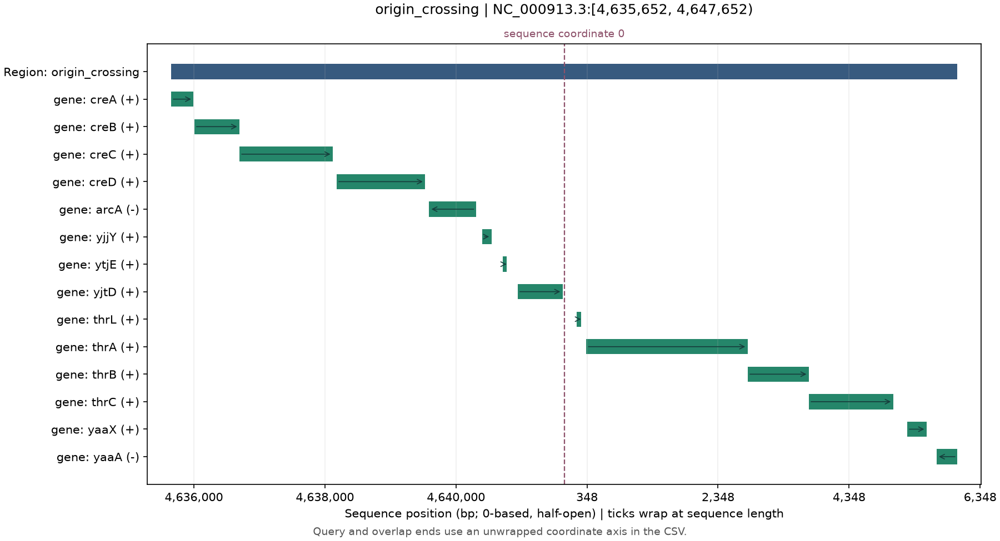
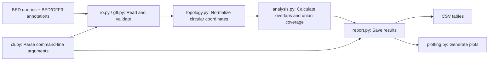

# Genome Region Reporter

A small Python library and command-line tool for annotating genomic regions
with overlapping genes and transposable elements (TEs).

## Real-data DEMO

[The DEMO folder](DEMO/README.md) includes downloaded annotation snapshots,
reproducible code, complete-chromosome overview plots and local PNG/SVG figures
for a circular bacterial chromosome and a linear plant chromosome. It demonstrates
GFF3 conversion, strand-aware drawing and queries crossing the circular coordinate
origin. See the demo for source accessions, checksums and validation results.



## How it works

The CLI coordinates input validation, overlap analysis and report generation.



## Install

Requires Python 3.10 or newer. From a clone of this repository:

```bash
python -m venv .venv
source .venv/bin/activate
python -m pip install -e ".[dev,docs]"
```

On Windows PowerShell, activate with `.venv\Scripts\Activate.ps1` instead.
For a normal installation without development tools, use `python -m pip install .`.
The package is not published on PyPI.

Check the installed version with `regionreport --version` or
`python -m regionreport --version`. See [CHANGELOG.md](CHANGELOG.md) for updates.

## Run the example

From the repository root, with the environment activated:

```bash
regionreport annotate --regions examples/regions.bed --genes examples/genes.bed --repeats examples/repeats.bed --out results/
```

Add `--no-plots` to generate CSV files without PNGs. Use a new or empty output
directory for each run; existing nonempty directories are never overwritten.

Outputs:

| File | Contents |
| --- | --- |
| `summary.csv` | Region length, unique feature counts, union-covered bases and coverage fractions |
| `overlaps.csv` | Each overlapping segment, original feature ID, coordinates, strand and label |
| `plots.csv` | Mapping from original region IDs to numeric plot filenames |
| `plots/region_0001.png`, ... | One labelled plot per region, including regions with no hits |
| `run.json` | Topology, species label, lengths, track availability, plot settings and runtime versions |

Use `--plot-format svg` or `--plot-format pdf` for vector output. Local plots
display at most 60 features and explicitly label omissions; CSVs remain complete.
Set `--max-features 20` to change this limit, for example:

```bash
regionreport annotate --regions examples/regions.bed --genes examples/genes.bed --repeats examples/repeats.bed --out results-small/ --max-features 20 --plot-format svg
```

The limit must be a positive integer. It counts features, not overlap segments;
a circular feature split across the origin still occupies one row. `run.json`
records the limit, file format and whether plots were enabled.

## Example data explained

All names and coordinates in the bundled example are synthetic teaching data.
The three files use the same four tab-separated BED fields, without a header:

| Field | Meaning |
| --- | --- |
| `chrom` | Chromosome name |
| `start` | Start coordinate |
| `end` | End coordinate |
| `name` | Region or annotation ID |

### 1. regions.bed: Which regions should we analyse?

[`examples/regions.bed`](examples/regions.bed) contains the regions to investigate:

```text
chr1	1000	2000	region_1
chr1	2500	3000	region_2
chr2	100	200	region_no_hits
```

The first row means: analyse the interval `[1000, 2000)` on `chr1` and call
it `region_1`.

BED coordinates are **0-based and half-open**: the start is included and the
end is excluded. This interval includes positions 1000 through 1999, so its
length is:

```text
2000 - 1000 = 1000 bp
```

The third region deliberately has no overlapping genes or TEs. It checks that
regions without hits remain in the summary with zero counts, rather than
disappearing from the results.

### 2. genes.bed: Where are the genes?

[`examples/genes.bed`](examples/genes.bed) uses the same format, with one gene
per row:

```text
chr1	1200	1800	Gene_A
chr1	2500	3000	Gene_B
chr1	3000	3200	Gene_adjacent
chr2	200	300	Gene_other_adjacent
```

For example:

```text
region_1: [1000, 2000)
Gene_A:   [1200, 1800)
```

`Gene_A` lies entirely inside `region_1`, so its overlap length is:

```text
1800 - 1200 = 600 bp
```

`Gene_adjacent` starts at 3000, exactly where `region_2` ends. The intervals
touch but share no bases, so they are adjacent, not overlapping.

This version expects one interval per gene. It does not merge multiple exons
or transcripts into a single gene record.

### 3. repeats.bed: Where are the TEs?

[`examples/repeats.bed`](examples/repeats.bed) contains the transposable-element
(TE) annotations:

```text
chr1	1500	1700	TE_1
chr1	900	1100	TE_2
chr1	2700	2800	TE_3
```

- `TE_1` overlaps `region_1` by 200 bp.
- `TE_2` crosses the left boundary of `region_1`. Only `[1000, 1100)` lies
  inside the region, giving an overlap of 100 bp.
- `TE_3` overlaps `region_2` by 100 bp.

### Expected summary

The complete example therefore produces these counts:

| Region | Genes | TEs |
| --- | ---: | ---: |
| `region_1` | 1 | 2 |
| `region_2` | 1 | 1 |
| `region_no_hits` | 0 | 0 |

## Input contract

In the default BED mode, inputs are tab-separated files with at least four columns:

```text
chrom    start    end    name
```

The line above describes the fields; actual files have **no header**. For example:

```text
chr1	1000	2000	region_1
```

- Coordinates are **0-based, half-open**: `[start, end)`. Length is `end - start`.
- Coordinates must be integers with `0 <= start < end <= 2**63 - 1`.
- Names must be nonempty and unique within each file. Genes should have one
  interval per gene; this version does not resolve transcripts/exons into genes.
- Empty files are valid. Empty annotations yield zero counts; empty regions
  produce header-only CSV files and no PNGs.
- Fields after the fourth are ignored, including strand. Overlaps are strand-independent.
- Chromosome names are matched exactly (`chr1` differs from `1`). All files must
  refer to the same genome assembly; the tool cannot verify assembly identity.
- GFF3 annotation inputs are accepted with `--input-format gff3`; queries still
  use BED4. FASTQ, BAM and VCF are not annotation inputs.
- `--repeats` is optional. Omitting it records an unavailable mobile-element
  track, rather than evidence that no mobile elements exist.
- The coordinate ordering above describes linear mode. Circular queries may use
  wrapped endpoints with `--circular`; see the explicit contract below.


See the [UCSC BED specification](https://genome.ucsc.edu/FAQ/FAQformat.html#format1).
Interval matching uses [Bioframe](https://bioframe.readthedocs.io/en/latest/guide-intervalops.html).

## Python API

```python
from regionreport import annotate_regions, read_bed, write_report

result = annotate_regions(
    read_bed("examples/regions.bed"),
    read_bed("examples/genes.bed"),
    read_bed("examples/repeats.bed"),
)
print(result.summary)
print(result.overlaps)
write_report(result, "results-api", plots=True)
```

`annotate_regions` accepts BED4 pandas DataFrames without reading or writing
files, and leaves its inputs unchanged. `read_bed` and `write_report` handle I/O.

## GFF3 and circular sequences

```python
from regionreport import annotate_regions, read_bed, read_gff3
from regionreport.gff import MOBILE_TYPES

source = "DEMO/data/raw/ecoli_MG1655.gff.gz"
genes = read_gff3(source, seqids=["NC_000913.3"])
mobile = read_gff3(source, feature_types=MOBILE_TYPES, seqids=["NC_000913.3"])
result = annotate_regions(
    read_bed("DEMO/data/processed/ecoli/local_regions.bed", circular=True),
    genes,
    mobile,
    circular=True,
    sequence_lengths=genes.attrs["sequence_lengths"],
    species="Escherichia coli K-12 MG1655",
)
```

`species` is a display/metadata label, not a topology heuristic. `circular=True`
requires a mapping of every input sequence ID to its length. All sequences in one
call share the chosen topology; process mixed linear/circular replicons separately.
Circular inputs accept either `start > end` or an unwrapped `end > length`, with
at most one lap. Equal endpoints are ambiguous and rejected; use `[0, length)` for
the whole sequence. Returned ends are unwrapped and can exceed sequence length.
Split overlap segments preserve the feature ID and count only once per query.

For BED inputs, provide lengths with `--sequence-lengths lengths.tsv`. This file
has two columns and no header, for example:

```text
chr1    5000
chr2    3000
```

Lengths must be positive integers. Blank lines and `#` comments are allowed.
Repeated sequence IDs must agree. Invalid rows report the filename and line
number; lengths that disagree with GFF3 annotations are also rejected.

`read_gff3` supports plain/gzipped GFF3 and selects `gene` and `pseudogene` rows by
default. It converts 1-based inclusive coordinates to 0-based half-open, retains
strand/display label/source type, and does not also count child CDS/exon records.
Multipart selected IDs are explicitly rejected rather than collapsed to bounding
spans. Strand is displayed, but overlap matching remains strand-independent.
Gene-span coverage includes introns; it is not coding-sequence coverage.

CLI equivalents are `--input-format gff3`, `--circular`, `--species`, and optional
`--seqid` filtering. Lengths are read from GFF3 `##sequence-region` directives or
provided in a headerless two-column TSV with `--sequence-lengths`. Conflicting
length declarations are rejected. See [DEMO instructions](DEMO/README.md).

## Development

```bash
python -m ruff check .
python -m ruff format --check .
python -m pytest --cov=regionreport --cov-report=term-missing
python -m sphinx -W --keep-going -b html docs docs/_build/html
python -m build
```

Tests use hand-calculated interval examples, malformed inputs, empty tables,
no-hit regions, safe output filenames, and the installed CLI. The CI workflow
checks Linux, macOS and Windows on Python 3.12, plus Python 3.10 and 3.14 on
Linux. It also builds a wheel and the API documentation. Tests use a normal
package installation, rather than an editable development installation.


## Possible next tasks

- Support multipart selected GFF3 features without merging intervening gaps.
- Support mixed sequence topologies within one API call.
- Benchmark much larger multi-genome annotations and add configurable track types.

